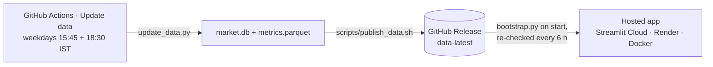

# Deploying Beemer

Beemer is a Streamlit app with a small SQLite database (about 21 MB, or 6 MB gzipped). Hosting it is straightforward. The one awkward part is the data: it is gitignored, and building it from scratch takes 8–10 minutes because screener.in is fetched politely, about one request every 4–5 seconds. So hosts never build it. They download a ready-made snapshot.



* **`.github/workflows/update-data.yml`** runs `update_data.py` on GitHub's servers every weekday, at 15:45 IST (prices only) and 18:30 IST (prices plus the weekly fundamentals refresh). It can also be started by hand from the **Actions** tab. It starts from the last published snapshot, so each run is incremental and takes a few minutes. The result is uploaded to the rolling release **`data-latest`** as `market.db.gz`, `metrics.parquet` and `manifest.json`. No secrets are needed because the built-in `GITHUB_TOKEN` is enough.
* **`bootstrap.py`** runs before the app starts on Docker and Render, and inside the app on every host, at most once an hour. It downloads the snapshot if data is missing, checks for a newer one every `BEEMER_DATA_MAX_AGE_HOURS` (default 6), validates it and swaps it in atomically. If nothing can be downloaded, it builds the full dataset on the host as a one-off fallback (8–10 minutes). Data built locally on your Mac is never overwritten.
* **If screener.in blocks GitHub's runners:** after 5 failures in a row the pipeline stops asking, keeps the fundamentals it already has and carries on with prices. The run still succeeds and shows a warning. To refresh fundamentals from your Mac instead, run `make update && make publish`.

> The repository is **public**, so the release files can be downloaded without a token. If you make the repo private, set `GITHUB_TOKEN` on the host (a fine-grained token with *Contents: read*), or point `BEEMER_DATA_URL` at any static bucket.

## Free hosting options (checked October 2026)

| Platform | Free tier | RAM / CPU | Sleeps when idle? | Private repo | Custom domain | Card needed | Verdict |
|---|---|---|---|---|---|---|---|
| **Streamlit Community Cloud** | Free, unlimited public apps | ~690 MB–2.7 GB, up to 2 cores (shared) | After **12 h** without traffic; any visitor can wake it with one click | ✅ (you can also restrict who can view the app) | ❌ only `yourname.streamlit.app` | No | **Primary.** Built for Streamlit, deploys straight from GitHub, redeploys on every push. |
| **Render** (free web service) | 750 instance-hours a month | 512 MB / 0.1 CPU | After **15 min**; about 1 min to wake | ✅ | ✅ (2 on Hobby) | No | **Alternative 1.** `render.yaml` included. Slow CPU, but a real URL and custom domain. |
| **Hugging Face Spaces** (Docker) | CPU Basic hardware is free | 16 GB / 2 vCPU | After ~48 h idle | ✅ (private Spaces) | ❌ (paid) | Creating Docker Spaces now needs **PRO** ($9/mo) | Use the `Dockerfile` if you already have PRO. |
| **Railway** | $5 trial, then $1 of credit a month | Up to plan limits | No (usage-billed) | ✅ | ✅ | Trial without a card | `Procfile` / `Dockerfile` work. Too little credit to run all month. |
| **Google Cloud Run** | 2M requests and 180k vCPU-s a month | Configurable | Scales to zero (cold start) | n/a (deploys an image) | ✅ | **Yes** | `Dockerfile` works. Set `--port 8080` or rely on `$PORT`. |
| **Fly.io** | No free tier for new users (trial only) | n/a | n/a | n/a | ✅ | Yes | Not free any more. |
| **Koyeb** | Free instance only inside the $29/mo Pro plan since Feb 2026 | 512 MB | Scales to zero after 1 h | n/a | ✅ | Yes | Not free any more. |

Limits change often; these are from each provider's docs as of October 2026.

**Why Streamlit Community Cloud is the primary:** it is the only option that is completely free with no card, has plenty of RAM for pandas and Plotly, deploys from a GitHub repo in about 2 minutes, and redeploys on every `git push`. Sleeping after 12 hours is much kinder than Render's 15 minutes. Its downsides are no custom domain and shared resources, both fine for a beta. When Beemer needs a custom domain, use Render (free, with a slow wake-up) or a small paid container running the included `Dockerfile`.

---

## Primary: Streamlit Community Cloud (about 5 minutes)

What's already in the repo: `requirements.txt` with pinned versions, `.streamlit/config.toml` with the theme at the repo root (where Community Cloud expects it), `app/main.py` as the entrypoint, and the published data snapshot.

1. Go to **https://share.streamlit.io** and click **Continue with GitHub**. Sign in as **RamBagga** and approve access to your repositories.
2. Click **Create app**, then **Deploy a public app from GitHub** (or **Yup, I have an app**).
3. Fill in:
   | Field | Value |
   |---|---|
   | Repository | `RamBagga/Beemer` |
   | Branch | `main` |
   | Main file path | `app/main.py` |
   | App URL | e.g. `beemer` → `beemer.streamlit.app` (pick any free subdomain) |
4. Open **Advanced settings**. Set **Python version** to **3.12**. Leave **Secrets** empty, since none are needed. To override a default, paste TOML such as `BEEMER_DATA_MAX_AGE_HOURS = "3"`; top-level secrets become environment variables.
5. Click **Deploy**. The first build installs dependencies (2–4 minutes). On first load the app downloads the data snapshot in a couple of seconds and shows "Loading the latest market data…".
6. Optional: in **Settings → Sharing**, choose who can view it. It is public by default for a public repo; switch it to invite-only for a private beta.

After that, every push to `main` redeploys automatically, and new data appears within about 6 hours of each Actions run. To force it, go to **Manage app → Reboot**.

Check that it's healthy: `make health URL=https://beemer.streamlit.app`

## Alternative: Render (free)

1. Go to **https://dashboard.render.com**, sign in with GitHub, then **New + → Blueprint** and pick `RamBagga/Beemer`.
2. Render reads `render.yaml`: a free web service in Singapore running Python 3.12 (from `.python-version`), with the health check on `/_stcore/health`. Click **Apply**.
3. Wait for the first deploy (about 5 minutes), then open `https://beemer.onrender.com` or whichever name Render assigns. It sleeps after 15 minutes idle, and the first visit after that takes about a minute.

## Anywhere with Docker (Cloud Run, Railway, Hugging Face Spaces, a VPS)

```bash
docker build -t beemer .
docker run --rm -p 8501:8501 beemer              # → http://localhost:8501
docker run --rm -p 8080:8080 -e PORT=8080 beemer  # hosts that inject $PORT
```

The image is `python:3.12-slim`, runs as a non-root user with uid 1000 (which Hugging Face needs), has a `HEALTHCHECK` on `/_stcore/health`, and downloads data on start. For **Hugging Face Spaces**, create a Docker Space, push this repo to it, and add this block to the top of the Space's `README.md`:

```yaml
---
title: Beemer
emoji: 🏎️
colorFrom: blue
colorTo: gray
sdk: docker
app_port: 8501
---
```

---

## Configuration

No secrets are required. Every setting is optional and listed in [`.env.example`](.env.example): `PORT`, `BEEMER_DATA_REPO`, `BEEMER_DATA_TAG`, `BEEMER_DATA_URL`, `BEEMER_DATA_MAX_AGE_HOURS`, `BEEMER_BOOTSTRAP_FALLBACK` (`full` | `prices` | `none`; `prices` skips fundamentals, which most pages need), `GITHUB_TOKEN` (only for a private repo), and `BEEMER_FUND_MAX_FAILS`.

## Operations

| Task | How |
|---|---|
| Refresh data now | Actions → **Update data** → *Run workflow* (`eod`, `snapshot` or `full`), or `gh workflow run update-data.yml -f mode=eod` |
| Push a full local build, e.g. fresh fundamentals from your Mac | `make update && make publish` |
| See what the hosts are serving | the `manifest.json` asset on the [data-latest release](https://github.com/RamBagga/Beemer/releases/tag/data-latest) |
| Health check any deployment | `scripts/healthcheck.sh https://…` |
| CI | `.github/workflows/ci.yml` installs on Python 3.12, bootstraps data, renders every page, checks health, and builds and boots the Docker image |

GitHub turns off scheduled workflows in public repos after 60 days with no commits. If that happens, re-enable **Update data** in the Actions tab.

---

## ⚠️ Before you charge money: data licensing and SEBI

* **Free data is for personal, non-commercial use only.** Yahoo Finance (via `yfinance`), NSE's website and archives, and screener.in all restrict commercial use and redistribution in their terms. A free, educational beta is a grey area. A **paid product needs licensed data**: an NSE or BSE data-feed licence, or an authorised vendor such as CMOTS, Accord Fintech, TrueData or Global Datafeeds. The swap is contained: only the two fetch functions in `update_data.py` (prices and fundamentals) need rewriting. The rest of the app reads the local database.
* **The published snapshot is public.** The `data-latest` release in a public repo redistributes data derived from those sources. That is fine for a personal project, but before a commercial launch move the snapshot to private storage (set `BEEMER_DATA_URL` or `GITHUB_TOKEN` and make the repo private) and switch to licensed data.
* **SEBI (Research Analysts) Regulations, 2014:** showing paying users stock scores, rankings or "buy/avoid"-style verdicts can count as research or investment advice. That would need SEBI registration as a Research Analyst (or Investment Adviser), along with disclosures and record-keeping. Keep Beemer clearly **educational** (the app already says "Educational only — not investment advice"), avoid personalised recommendations and price targets, and get a securities lawyer's view before you monetise.
