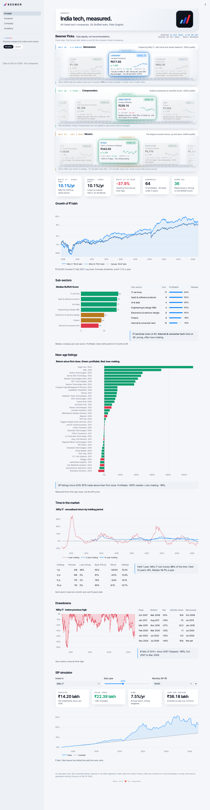
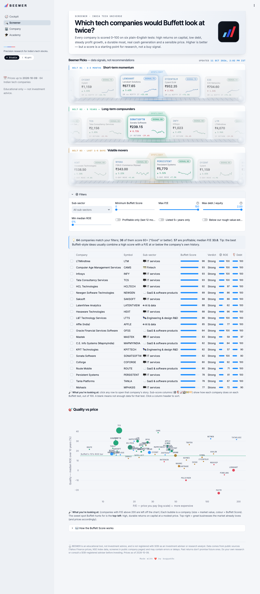
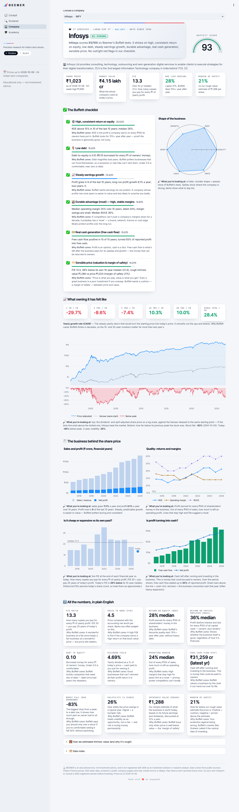
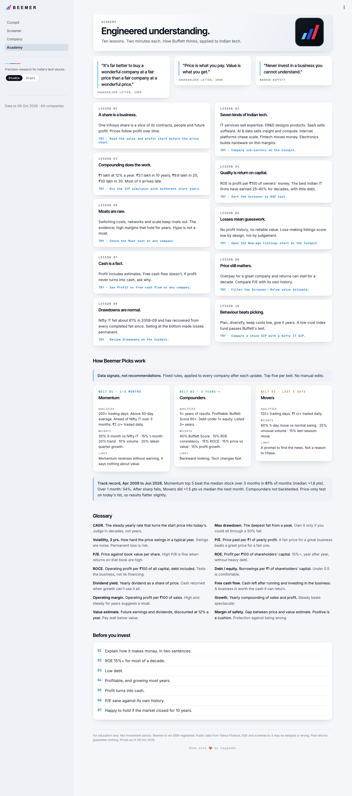

<p align="center">
  
</p>

<h3 align="center">Precision research for India's tech stocks</h3>

<p align="center">
Buffett-style insights on Indian AI, SaaS and tech companies, explained simply.<br>
Up to 30 years of NSE/BSE price history · 12 years of fundamentals · a transparent 0–100 Buffett Score · refreshed every trading day.
</p>

<p align="center">
  
</p>

> **Educational tool, not investment advice.** Read [Data licensing](#data-licensing--read-before-selling) before selling this publicly.

## Why Beemer
Most stock screeners throw 50 ratios at you and leave you to figure out what they mean. Beemer covers **64 Indian-listed tech companies**, from IT services, ER&D, SaaS and AI to internet platforms, fintech and chip design. It scores each one against the questions Warren Buffett asks, and explains every number in one plain-English line.

## Getting started

### 1. Prerequisites
- macOS or Linux
- Python 3.11+ (macOS: `brew install python@3.12`; `start.sh` picks the best version automatically)
- Git, and an internet connection. **No API keys needed.**

### 2. Clone and run
```bash
git clone git@github.com:RamBagga/Beemer.git
cd Beemer
./start.sh
```
Then open **http://localhost:8501**.

The first run creates a virtual environment, installs dependencies and downloads the latest data snapshot that GitHub Actions publishes every weekday, which takes about a minute. If no snapshot is available, it builds the data from scratch instead (8 to 10 minutes). After that, the app starts in seconds.

### Deploy it (free)
Beemer is set up to deploy to **Streamlit Community Cloud**: sign in at [share.streamlit.io](https://share.streamlit.io) with GitHub, choose repo `RamBagga/Beemer`, branch `main`, main file `app/main.py`, Python 3.12, then click Deploy. Render (`render.yaml`) and Docker (`Dockerfile`) configs are included too. See **[DEPLOYMENT.md](DEPLOYMENT.md)** for the comparison of free hosts, how data reaches the cloud, and the licensing caveats.

### 3. Everyday commands
| Command | What it does |
|---|---|
| `./start.sh` | Start the app in the background |
| `./start.sh --fg` | Run in the foreground (see logs live) |
| `./start.sh --status` | Is it running, and on which port? |
| `./start.sh --stop` | Stop the app |
| `./start.sh --cron` | Install the weekday auto-refresh (3:45 PM and 6:30 PM IST) |
| `.venv/bin/python update_data.py` | Refresh data manually right now |
| `make help` | Every other task: `make test` (render all pages), `make publish` (upload data for the cloud), `make docker-build` … |

### 4. Troubleshooting
- **Port 8501 is busy:** `start.sh` automatically uses the next free port. Run `./start.sh --status` to see which one.
- **The app won't start:** check `logs/streamlit.log`.
- **Data looks old:** run `.venv/bin/python update_data.py`, or install the schedule with `./start.sh --cron`. Cron jobs only run while the Mac is awake.
- **Start from scratch:** delete `data/market.db`, `data/metrics.parquet` and `.venv`, then run `./start.sh`.

### 5. Learn the codebase
Read [ARCHITECTURE.md](ARCHITECTURE.md) for the data flow diagram and module map, and [design/beemer-design-board.md](design/beemer-design-board.md) for the design system.

## Screenshots
| Screener | Company | Academy |
|---|---|---|
|  |  |  |

## Pages
| Page | What it shows |
|---|---|
| **Cockpit** | Nifty IT vs Nifty 50 vs Sensex, sub-sector instrument panel, new-age listing tracker, rolling returns, crash & recovery history, SIP vs lump-sum simulator (indices or any stock) |
| **Screener** | All companies ranked by Buffett Score with six sub-scores; filters for sub-sector, P/E, debt, ROE, profitability, listing age, margin of safety; quality-vs-price map |
| **Company** | Verdict, score gauge, Buffett checklist with explanations, 1/3/5/10/20-yr returns, drawdowns, sales/profit, ROE/ROCE/margins, P/E vs own history, FCF vs profit, rough intrinsic value with assumptions, data notes |
| **Academy** | 10 short lessons (incl. tech-specific ones), glossary, pre-buy checklist |

## Universe
`data/universe_tech.csv` — 64 curated companies tagged by sub-sector and theme. Edit the CSV to add/remove names
(NSE symbol, name, subsector, theme, note) and re-run `update_data.py`. Other universes: `--universe nifty50|nifty100|nifty500`.
Notes: LTIMindtree trades as **LTM** (formerly LTIM); Unicommerce is **UNIECOM**; MosChip has NSE data only from 2025 (BSE-listed before).

## Buffett Score (0–100)
Six transparent tests, rescaled when a test lacks data:
⚙️ consistent ROE > 15% (20) · 🛡️ low debt (15) · 📈 steady profit growth (20) · 🏰 moat proxy: high & stable operating margins (15) ·
💵 free cash flow (15) · 🏷️ valuation: P/E vs own 10-yr median + margin of safety vs a simple intrinsic value (15).
Intrinsic value = 10 yrs of EPS growing at the median of (10y sales CAGR, 10y & 5y profit CAGR, capped 18%), dividends at the usual payout,
terminal P/E 15 (or the historical median if lower), discounted at 12%. Deliberately simple — a sanity check, not a target price.

## Data pipeline
- `update_data.py` — idempotent & incremental. Prices: last 10 days re-fetched and upserted; if a split/dividend adjustment is detected
  on overlap, that symbol's full history is reloaded. Fundamentals: refreshed when older than 7 days, 1 request / ~4–5 s, raw HTML cached in `data/screener_cache/`.
- `analytics.py` — price cleaning (drops one-day Yahoo glitches; rescales unadjusted splits/demergers: single-day moves > ±30% while the market moved < 8%), metrics and score.
- Storage: SQLite `data/market.db` (prices, fundamentals, universe, run log) + `data/metrics.parquet` (one row per company).

### Schedule (weekdays, IST)
| Time | Job | Command |
|---|---|---|
| 15:45 | Close snapshot: prices + metrics | `scripts/run_update.sh snapshot` (`update_data.py --prices-only`) |
| 18:30 | End-of-day: prices + fundamentals if stale + metrics | `scripts/run_update.sh eod` |

`scripts/install_cron.sh` writes both cron lines (auto-converts to a UTC machine clock: 10:15 / 13:00 UTC) and starts `cron` if needed (Linux; on macOS cron is built in, jobs run only while the Mac is awake).
Logs: `logs/update_snapshot.log`, `logs/update_eod.log`. The app re-reads data every 10 minutes.

## Free / public Indian market data sources — what we found
| Source | What | Pros | Cons |
|---|---|---|---|
| **yfinance** (Yahoo Finance) — github.com/ranaroussi/yfinance | Daily OHLCV for `.NS`/`.BO`, indices (`^NSEI` from 2007, `^BSESN` from 1997, `^CNXIT` from 2007) | No key, long history (some NSE stocks from 1996), split/dividend-adjusted series, easy | Unofficial; pre-2006 NSE data has glitches and some unadjusted demergers (we clean them); Yahoo terms = personal use |
| **NSE archives / bhavcopy** — nseindia.com/all-reports, archives.nseindia.com | Official daily EOD files, index constituent CSVs | Official, complete EOD per day | One file per day; needs browser-like headers/cookies for some endpoints; NSE terms restrict commercial use |
| **jugaad-data** — github.com/jugaad-py/jugaad-data | Python lib for NSE stock/index history, bhavcopies, live quotes, niftyindices.com index data | Free, caching built-in, popular on r/IndiaInvestments & r/algotrading | Scrapes NSE website; breaks when NSE changes; rate limits |
| **nsepython / nselib / nsefeed / pybhav** | Similar NSE wrappers (nsefeed = yfinance-style; pybhav = bulk bhavcopy with caching) | Free, active | Unofficial; NSE deprecated some historical index endpoints |
| **NSE MCP (mcp.nseindia.in)** | ~5 yrs EOD bhavcopy + delayed live snapshot via MCP, no auth | Official, no key | Only ~5 years; NSE disclaimer: informational, non-commercial use |
| **BSE public APIs** — api.bseindia.com (undocumented) | Quotes, corporate actions, announcements, results filings | Free, broad coverage incl. BSE-only names | Undocumented, can change; terms apply |
| **XBRL filings (NSE/BSE)** — e.g. `india-xbrl-filings`, `nse-xbrl` on PyPI | Company-filed financial results in machine-readable XBRL | Primary source — the cleanest legal base for fundamentals | Must parse/normalise yourself; Integrated Filing format only since 2024/25 |
| **screener.in** (public company pages) | 10–12 yrs P&L, balance sheet, cash flow, ratios, shareholding | Best free fundamentals for Indian cos; robots.txt allows company pages | **No API**; ToS = personal, non-commercial use; we fetch politely (1 req/4–5 s, cached, weekly) |
| **Tickertape / Trendlyne** | Research UIs, screeners, scores | Great UX reference | No public API (Tickertape web endpoints are undocumented; Trendlyne sells a paid MCP connector) — not used |

**What Beemer uses today:** yfinance (prices, indices), NSE archives (index lists), screener.in public pages (fundamentals).

## Data licensing — read before selling
Yahoo, NSE and screener.in all limit their free data to personal / non-commercial use. For a paid public product you will need
licensed data: e.g. an NSE/BSE market-data licence or a licensed vendor (CMOTS, Accord Fintech, ACE Equity/Capitaline, Drishti, DalalOS, etc.)
for prices, and XBRL filings parsed in-house or a licensed fundamentals feed. The pipeline is modular (`update_data.py` fetchers) so sources can be swapped.
Also review SEBI's Research Analyst / Investment Adviser rules — scores and "margin of safety" displays should stay clearly educational.

## Project layout
```
start.sh                 one-command setup + run
update_data.py           data pipeline (cron entry point)
analytics.py             metrics, price cleaning, Buffett Score
app/main.py              Streamlit entry (navigation)
app/beemer.py            design system: CSS, Plotly template, components, copy
app/views/*.py           Cockpit, Screener, Company, Academy
.streamlit/config.toml   dark theme (repo root, as Streamlit Cloud requires)
bootstrap.py             downloads the published data snapshot on fresh hosts
Dockerfile · render.yaml · Procfile · Makefile · .env.example   deployment configs
.github/workflows/       update-data.yml (weekday data refresh → data-latest release) · ci.yml
design/                  design board (md/html/png), logo & wordmark SVGs
scripts/                 cron wrapper + installer, publish_data.sh, smoke_test.py, healthcheck.sh, check_pages.py (headless render check + screenshots), shot.py
requirements-dev.txt     playwright + pillow for the screenshot scripts
data/universe_tech.csv   curated universe
```

## Roadmap
- Licensed data feeds for a commercial launch
- Public deployment (configs ready, see DEPLOYMENT.md)
- Bigger universe (Nifty 500), watchlists and alerts

## License
See [LICENSE](LICENSE).
